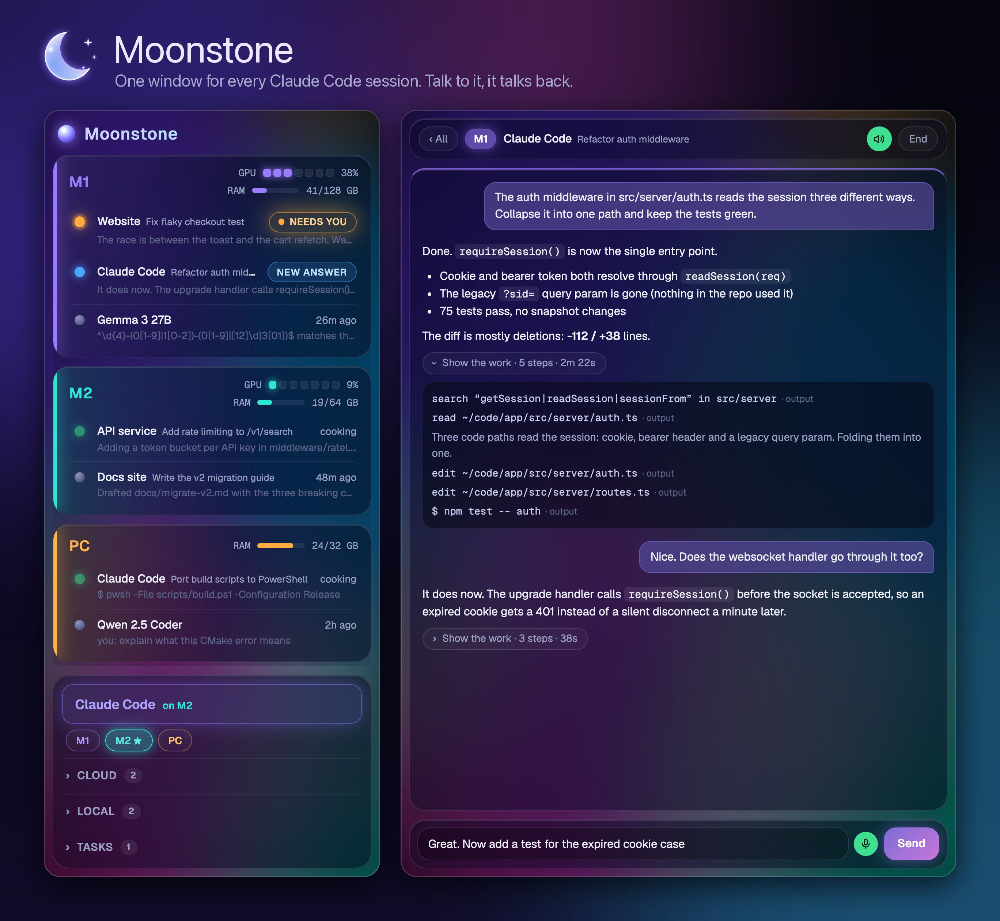
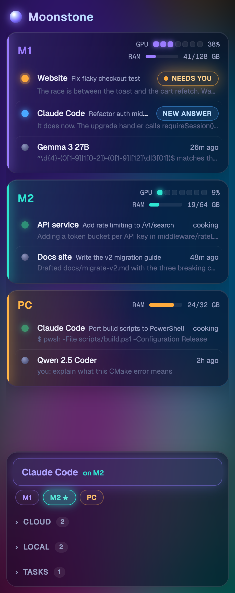
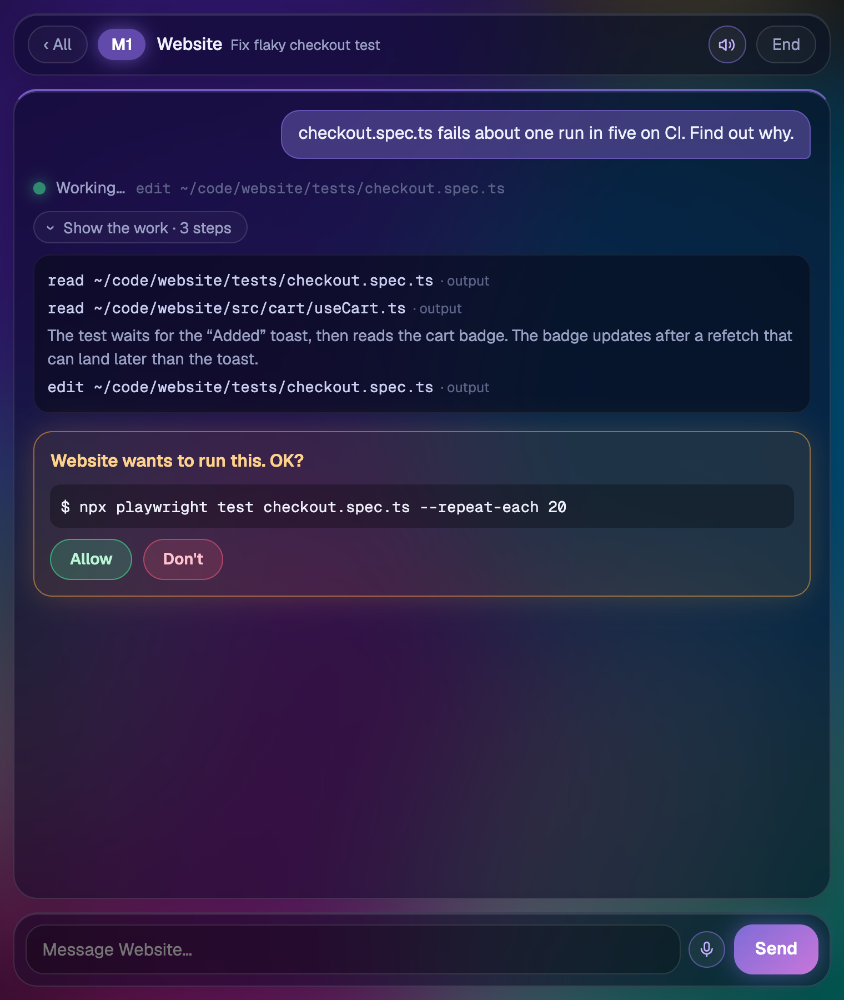
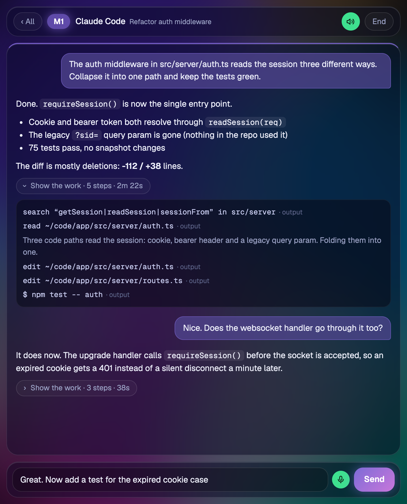
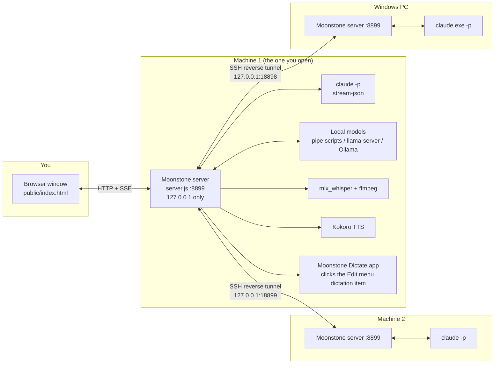

<div align="center">


# Moonstone

**A local voice control panel for your Claude Code sessions, across every machine you own.**

[](LICENSE)


[Website](https://nicedreamzapp.github.io/moonstone/) · [Quick start](#quick-start) · [Configuration](#configuration) · [Security](#security-model)



</div>

<a id="why"></a>
<picture><source media="(max-width: 610px), (min-width: 768px) and (max-width: 895px)" srcset="https://raw.githubusercontent.com/nicedreamzapp/moonstone/5c77882590db9d36e33f75775f3816a4e3b4aaf5/assets/readme/s01-banner-m.svg"><source media="(max-width: 1149px)" srcset="https://raw.githubusercontent.com/nicedreamzapp/moonstone/5c77882590db9d36e33f75775f3816a4e3b4aaf5/assets/readme/s01-banner-mid.svg"></picture>
<picture><source media="(max-width: 610px), (min-width: 768px) and (max-width: 895px)" srcset="https://raw.githubusercontent.com/nicedreamzapp/moonstone/5c77882590db9d36e33f75775f3816a4e3b4aaf5/assets/readme/s01-r1-m.svg"><source media="(max-width: 1149px)" srcset="https://raw.githubusercontent.com/nicedreamzapp/moonstone/5c77882590db9d36e33f75775f3816a4e3b4aaf5/assets/readme/s01-r1-mid.svg"></picture>

🧭 **The problem** · We run a lot of Claude Code sessions at once, on a couple of Macs and a Windows PC. Keeping track of which terminal was waiting on a permission prompt, which one had finished, and which machine had room for another job turned into a job of its own.

✅ **What it gives you** · You can open any session, read the answer, approve the next step, and send the next instruction by voice while your hands are busy with something else.

🧠 **Local models too** · Local models sit in the same list as Claude, so a quick question to a model on your own GPU is one tap away.

🔒 **Private by design** · It binds to `127.0.0.1` and machines reach each other over SSH tunnels you already trust.


<a id="sessions"></a>
<picture><source media="(max-width: 610px), (min-width: 768px) and (max-width: 895px)" srcset="https://raw.githubusercontent.com/nicedreamzapp/moonstone/5c77882590db9d36e33f75775f3816a4e3b4aaf5/assets/readme/s02-banner-m.svg"><source media="(max-width: 1149px)" srcset="https://raw.githubusercontent.com/nicedreamzapp/moonstone/5c77882590db9d36e33f75775f3816a4e3b4aaf5/assets/readme/s02-banner-mid.svg"></picture>
<picture><source media="(max-width: 610px), (min-width: 768px) and (max-width: 895px)" srcset="https://raw.githubusercontent.com/nicedreamzapp/moonstone/5c77882590db9d36e33f75775f3816a4e3b4aaf5/assets/readme/s02-r1-m.svg"><source media="(max-width: 1149px)" srcset="https://raw.githubusercontent.com/nicedreamzapp/moonstone/5c77882590db9d36e33f75775f3816a4e3b4aaf5/assets/readme/s02-r1-mid.svg"></picture>

🖥️ **Grouped by machine** · Each machine has a live GPU gauge (macOS) and a RAM bar. RAM is measured the way Activity Monitor counts "Memory Used", so a model that is loaded but idle still shows up.

🔀 **Two kinds of sessions** · *Dock* sessions are headless `claude -p` processes that Moonstone starts and owns. *Terminal* sessions are Claude Code processes already running in a terminal; Moonstone reads their transcripts, and typing into one stops the terminal copy and resumes the same conversation inside Moonstone with its full history.

🚀 **Launchers** · Launchers start new sessions. A launcher that exists on several machines gets machine chips; the starred chip is the least busy machine (fewest sessions working, then lowest GPU, then your preferred order). Tap a chip to pin a launcher to a machine.

⚡ **Why warm spares** · Loading MCP servers can take a while, so Moonstone keeps the spare ready.




<br clear="right">


<a id="conversations"></a>
<picture><source media="(max-width: 610px), (min-width: 768px) and (max-width: 895px)" srcset="https://raw.githubusercontent.com/nicedreamzapp/moonstone/5c77882590db9d36e33f75775f3816a4e3b4aaf5/assets/readme/s03-banner-m.svg"><source media="(max-width: 1149px)" srcset="https://raw.githubusercontent.com/nicedreamzapp/moonstone/5c77882590db9d36e33f75775f3816a4e3b4aaf5/assets/readme/s03-banner-mid.svg"></picture>
<picture><source media="(max-width: 610px), (min-width: 768px) and (max-width: 895px)" srcset="https://raw.githubusercontent.com/nicedreamzapp/moonstone/5c77882590db9d36e33f75775f3816a4e3b4aaf5/assets/readme/s03-r1-m.svg"><source media="(max-width: 1149px)" srcset="https://raw.githubusercontent.com/nicedreamzapp/moonstone/5c77882590db9d36e33f75775f3816a4e3b4aaf5/assets/readme/s03-r1-mid.svg"></picture>

🔐 **Permission prompts** · Permission prompts arrive as an Allow / Don't card. Moonstone runs Claude Code with `--permission-prompt-tool stdio`, so it answers the real prompt; nothing is auto-approved. Questions Claude asks with options (`AskUserQuestion`) show up as buttons.

📂 **The work folds away** · Each answer shows the final text; the tool calls behind it sit under a "Show the work · 5 steps · 2m 22s" bar.

🔵 **Your turn** · When the latest answer ends by asking you something, the session gets a pulsing blue YOUR TURN badge in the list, sorted right under NEEDS YOU, with "Waiting on you:" and the question as its last line. Inside the chat, a banner quoting the question sits above the message box, and the tab title starts with "● Your turn", so you can tell from another window.

⏳ **Background work stays visible** · When Claude starts a background agent, a `run_in_background` command or a monitor, a card pinned to the bottom of the chat shows it until it finishes. The card has a pulsing dot, its latest step ("Reading huggingface.co/...", or the last line of the command's output) with how long ago that changed, a progress bar, and an ETA with a finish time that ticks every second. Moonstone reads all of this from the session transcript, so nothing has to be registered. The ETA comes from a `~5m` hint in the task description if there is one, otherwise from the median time of past tasks of the same kind (kept in `bg-history.json`). A long script running outside a session can report its own progress with `tools/job start <id> "what it's doing" --total N`, `tools/job tick <id> <done>` and `tools/job done <id>`. The cards fold into one small "● 2 working" pill until you tap it, and each agent card carries a badge for the model doing the work (Opus, Sonnet, Haiku). A card only stays while its work is provably alive: the chat's Claude process is running and was already running when the work started, an agent has written something in the last 20 minutes and did not stop on a usage limit, and it is younger than a few hours. Work that died quietly stops pulsing on its own.

🔢 **Live token count** · The Working line counts tokens as they stream and ticks the seconds, and every finished answer shows what it cost.

🏷️ **Subjects and requests** · Every chat gets a short subject from your first real message, refined once by Haiku (rename it with a tap, and your name wins). Next to it, a Requests pill keeps a checklist of what you asked for in that chat, with "3/4" done. Haiku reads only when you said something new, and a short "ok" or "continue" never counts as a request. Long chats change their mind, so a request a later one replaced shows as replaced, one you called off as cancelled, one whose only remaining step is someone else's (a store review, a delivery) as waiting, and one handed to another chat as sent. None of those count against the total. A Subjects panel lists what the chat covered, in order; tap one to jump there.

🟢 **Safe to close** · If you ask Claude (in your `CLAUDE.md`) to end status messages with a line like `CLOSE: safe` or `CLOSE: not yet - waiting on the deploy`, Moonstone reads it: a green "Safe to close" pill in the list and the chat, or the reason it is still open. Tap the pill in the chat to close it. A message that still asks you something is never safe.

🗂️ **Done list** · A chat whose requests all read done and that has sat idle for an hour moves into a small Done list under its machine, history intact, with a Reopen button. Nothing is ever tidied away while it is working, waiting on you, has open requests, background work or messages waiting, and anything new in a closed chat brings it straight back. Each Sunday the Done list drops chats closed more than a week ago; transcripts stay on disk.

🔁 **One tap between chats** · Inside a chat, every open chat on every machine sits in a row under the header, coloured by machine, with dots for the ones that need you. Switching is one tap instead of going back to the list.

🧹 **Fresh chat** · When a chat's memory passes 25% and nothing runs in the background, it offers one "Fresh chat" pill. Tap it and the chat writes a short handoff note, then a new chat in the same folder starts from that note.

🛟 **When Claude runs out** · Point `fallback` at one of your local pipe launchers and a chat that hits the usage limit keeps going in the same card on that model, which is told which transcript to pick up from. Its replies sit under a banner with a "Back to Claude" button, and once the limit resets (or any chat on the machine gets a real Claude answer) the next message goes back to Claude.

📎 **Photos and files** · The + next to the message box attaches photos or files. They are saved on the machine running that chat, wait as thumbnails until you send, and reach Claude as file paths it can open. Drop or paste a picture anywhere on the window to attach it, and tap one to see it full size. Drop any other file, folder or app and its full path lands in the box, the way a terminal does it.





<a id="voice"></a>
<picture><source media="(max-width: 610px), (min-width: 768px) and (max-width: 895px)" srcset="https://raw.githubusercontent.com/nicedreamzapp/moonstone/5c77882590db9d36e33f75775f3816a4e3b4aaf5/assets/readme/s04-banner-m.svg"><source media="(max-width: 1149px)" srcset="https://raw.githubusercontent.com/nicedreamzapp/moonstone/5c77882590db9d36e33f75775f3816a4e3b4aaf5/assets/readme/s04-banner-mid.svg"></picture>
<picture><source media="(max-width: 610px), (min-width: 768px) and (max-width: 895px)" srcset="https://raw.githubusercontent.com/nicedreamzapp/moonstone/5c77882590db9d36e33f75775f3816a4e3b4aaf5/assets/readme/s04-r1-m.svg"><source media="(max-width: 1149px)" srcset="https://raw.githubusercontent.com/nicedreamzapp/moonstone/5c77882590db9d36e33f75775f3816a4e3b4aaf5/assets/readme/s04-r1-mid.svg"></picture>



**Push to talk.** Tap the mic, talk, then tap it again and it stops listening and sends. Pressing Enter while the mic is listening does exactly the same thing. Tapping the mic also silences narration right away, and nothing is read aloud while the mic is on. While you dictate, the conversation holds still instead of redrawing under your words, then catches up a moment later. Moonstone tries three paths, best first:

1. **Your OS's own dictation.** On macOS a small signed helper app opens the focused app's *Edit* menu and clicks *Start Dictation* or *Stop Dictation*, then checks that it really changed: a microphone running in CoreAudio counts as on, otherwise a freshly opened menu decides (the menu label can lag a moment, so it is read again after it settles). It presses only once, because a second press would toggle dictation back. If the stop cannot be confirmed you get a note to tap the mic again. On Windows it presses Win+H. Words type straight into the message box at native speed.
2. **The browser's speech recognition**, where the browser can actually run it. On a phone this is the first choice, started inside the tap itself because iOS only lets a page use the mic in direct response to one. If it fails once, Moonstone remembers and stops trying it.
3. **Local Whisper.** The browser records, posts the audio to `/api/stt`, and the server runs `ffmpeg` and `mlx_whisper` (`mlx-community/whisper-large-v3-turbo` by default) on the same machine. While you talk it keeps re-transcribing what you have said so far, one request at a time, so the words trail your voice instead of arriving at the end. Recordings are capped at two minutes.

**Narration.** Tap the speaker in a conversation and every answer that finishes from then on is read aloud. The server sends the text, split into sentences, to a local TTS server (Kokoro, voice `af_heart` by default) and plays the WAVs back in order. Code blocks are skipped and links become "a link". With Moonstone open on several machines, only the window you touched last speaks. Tap the mic to cut it off mid sentence. Local-model chats get one more step first: their answers tend to read like a log file, so the server has a small local model (`speak` in config.json) rewrite each one as a few plain spoken sentences, then strips any file paths, ports, ids and long numbers that are left. With no `speak` model set, the strip step runs alone. Missed an answer? **Hear again** reads the last one from the top.


<a id="local-models"></a>
<picture><source media="(max-width: 610px), (min-width: 768px) and (max-width: 895px)" srcset="https://raw.githubusercontent.com/nicedreamzapp/moonstone/5c77882590db9d36e33f75775f3816a4e3b4aaf5/assets/readme/s05-banner-m.svg"><source media="(max-width: 1149px)" srcset="https://raw.githubusercontent.com/nicedreamzapp/moonstone/5c77882590db9d36e33f75775f3816a4e3b4aaf5/assets/readme/s05-banner-mid.svg"></picture>

💤 **Idle shutdown** · Local models are memory hungry, so a pipe chat or a server Moonstone started is shut down after 30 idle minutes and comes back on the next message.

🧩 **Same server everywhere** · Every machine runs the same server.js.


| Launcher kind | What it runs |
|---|---|
| `claude` | A headless Claude Code session (`claude -p --input-format stream-json --output-format stream-json`) |
| `pipe` | A script that reads one line on stdin and prints `›` when it is ready for the next. Good for a llama.cpp or MLX chat loop. |
| `api` | Any OpenAI-style `/v1/chat/completions` server (llama.cpp `llama-server`, Ollama, LM Studio). With a `serve` command, Moonstone starts the server on the first message. |
| `open` | Opens an app on that machine. |

🔑 **Keys and hosted models** · A `claude` launcher with `keyEnv` runs Claude Code on that API key instead of your plan, and the chat keeps it across restarts. An `api` launcher can also point at a hosted `https` endpoint with `keyEnv`. Keys come from the environment or from an `envFile` (`KEY=value` lines) you keep outside any synced folder; they never go in `config.json`.

📟 **Pipe scripts can report back** · A pipe script can print two invisible codes the window never shows: `ESC ] 7717 ; tok=N BEL` for the live token count, and `ESC ] 7717 ; ctx=used/limit BEL` for the memory meter. Progress bars from model libraries are filtered out.



Every machine runs the same `server.js`. The one you open in the browser lists its peers in `config.json`, polls each peer's `/api/local`, relays their change events, and forwards any request for a session named `<peer>~<id>` to that peer. Transcripts are read from `~/.claude/projects/**/<session>.jsonl` incrementally, so a dock session and a terminal session look the same.


<a id="quick-start"></a>
<picture><source media="(max-width: 610px), (min-width: 768px) and (max-width: 895px)" srcset="https://raw.githubusercontent.com/nicedreamzapp/moonstone/5c77882590db9d36e33f75775f3816a4e3b4aaf5/assets/readme/s06-banner-m.svg"><source media="(max-width: 1149px)" srcset="https://raw.githubusercontent.com/nicedreamzapp/moonstone/5c77882590db9d36e33f75775f3816a4e3b4aaf5/assets/readme/s06-banner-mid.svg"></picture>
<picture><source media="(max-width: 610px), (min-width: 768px) and (max-width: 895px)" srcset="https://raw.githubusercontent.com/nicedreamzapp/moonstone/5c77882590db9d36e33f75775f3816a4e3b4aaf5/assets/readme/s06-r1-m.svg"><source media="(max-width: 1149px)" srcset="https://raw.githubusercontent.com/nicedreamzapp/moonstone/5c77882590db9d36e33f75775f3816a4e3b4aaf5/assets/readme/s06-r1-mid.svg"></picture>

You need Node 18 or newer and [Claude Code](https://docs.claude.com/en/docs/claude-code) installed.

```bash
git clone https://github.com/nicedreamzapp/moonstone.git
cd moonstone
cp config.example.json config.json   # edit launchers and peers, or start with {}
node server.js
```

Open **http://localhost:8899**. Set `DOCK_PORT` to use another port.

Want to look around first? `node tools/demo-server.js` serves the real UI on http://localhost:8890 with made-up sessions. That is what the screenshots here were taken from.

### Linking machines

Run `node server.js` on each machine. On the machine you will open in the browser, give each peer a local port and forward it over SSH. From the peer:

```bash
ssh -N -R 18899:127.0.0.1:8899 you@main-machine
```

or from the main machine:

```bash
ssh -N -L 18899:127.0.0.1:8899 you@peer-machine
```

Then list it in `config.json` as `{"id": "m2", "name": "M2", "url": "http://127.0.0.1:18899"}`. A peer that does not answer shows as offline; its sessions come back when the tunnel does. Run the tunnel under `launchd`, `systemd` or `autossh` if you want it to survive reboots.

### Messages between chats

Every chat has an id that works from any machine, like `m1~c84627d9` (a Moonstone chat) or `m1~t:05785fee` (a terminal one). From inside a chat, Claude can hand another chat a result with `chat-send <id> "text"`. The server delivers it locally or carries it to the other machine over the tunnel it already has. An idle chat gets it as a new turn, clearly marked as coming from another chat and not from you; a busy or terminal chat gets it on its next turn. `chat-send status` shows receipts (queued, delivered, read), `chat-send list` shows every live chat and its id.

A few guards keep this sane: a chat you are typing in is never woken, nor one waiting on you, a sender gets a few wakes per 10 minutes, and a back-and-forth stops after three hops. Set `chatMail.repliesOnly` if you want a chat to accept messages only from a chat it messaged first.

To set it up, put `chat-send` on your PATH and add the hook:

```bash
mkdir -p ~/.local/bin ~/.claude/hooks
printf '#!/bin/sh\nexec node "%s" "$@"\n' "$PWD/tools/chat-send.js" > ~/.local/bin/chat-send && chmod +x ~/.local/bin/chat-send
cp tools/moonstone-peers.py ~/.claude/hooks/
```

Then add `python3 ~/.claude/hooks/moonstone-peers.py` as a `UserPromptSubmit` hook in `~/.claude/settings.json`. Before each prompt the hook tells the chat which other chats are live, what they were last asked and which files they wrote recently, so two chats don't edit the same file blind. It also hands over any waiting messages. It is plain code with no model calls and gives up after about a second.

### Keeping it up to date

`updater.js` keeps a git-clone install current. Run `node updater.js` every few minutes (launchd, cron or Task Scheduler). It fetches the branch, checks the new `server.js` with `node --check`, and asks the running server whether anything is working that a restart would kill: a busy chat, a permission prompt, background work, or anything you did in the last 3 minutes. When it is quiet it fast-forwards and runs `autoupdate.restart`. If the new server does not come up, the previous commit goes back and the bad one is skipped. A folder with local edits is never touched, and an `update.hold` file pauses it. Open windows reload the page by themselves.

### macOS dictation helper

The mic's best path on a Mac needs a tiny helper app, because clicking a menu item in another app requires the Accessibility permission, and that permission belongs to a signed app, not to Node.

```bash
cd mac
./build.sh "Apple Development: Your Name (XXXXXXXXXX)"   # any stable codesign identity
open -g ~/Applications/"Moonstone Dictate.app" --args check
```

Then allow **Moonstone Dictate** under System Settings > Privacy & Security > Accessibility. Find your identity with `security find-identity -v -p codesigning`. Without one, `./build.sh` signs ad-hoc (`codesign -s -`), which works but loses the permission on every rebuild.

Dictation itself must be turned on in System Settings > Keyboard. The helper accepts `start`, `stop`, `status` and `check`. `mac/micon.swift` is a small companion that prints `1` when any microphone is in use, handy for checking the helper's work by hand.

### Windows notes

- Moonstone looks for `claude.exe` in `%USERPROFILE%\.local\bin` and `claude.cmd` in `%APPDATA%\npm`. Set `"claude"` in `config.json` if yours lives elsewhere.
- The mic presses **Win+H** for Windows voice typing.
- There is no MLX on Windows, so for the Whisper fallback set `stt.cmd` to your own transcriber, or `stt.forward` to a Mac running Moonstone.
- `pipe` launchers are started with `/bin/bash`, so on Windows use `api` launchers (llama-server, Ollama) for local models.
- The GPU gauge is macOS only; RAM works everywhere.

<a id="configuration"></a>

### Configuration

Everything lives in `config.json` next to `server.js`. All keys are optional. See [`config.example.json`](config.example.json).

| Key | What it does |
|---|---|
| `machine`, `name`, `color` | This machine's id, display name and accent color. |
| `peers` | `[{id, name, url, color}]`, other Moonstone servers reached through `127.0.0.1` tunnels. |
| `prefer` | Machine ids in order of preference when picking the best machine for a launcher. Defaults to this machine, then peers. |
| `launchers` | `[{label, group, kind, cwd, mode, color, note, ...}]`. `group` is `main`, `cloud`, `local` or `tasks`. `mode` is a Claude Code permission mode. `pipe` needs `cmd`; `api` needs `url` and takes `serve: {cmd, args}`, `system`, `model`, `ctxLimit` and `health` (default `/health`, use `/` for Ollama); `open` needs `path`. A `claude` launcher can take `opening`, a shell command whose output becomes the new chat's first message. `keyEnv` (and optionally `envFile`) names an API key: on a `claude` launcher Claude Code runs on that key, on an `api` launcher it is sent as a bearer token. Changes are picked up without a restart. Without this key, Moonstone looks for Ghostty launcher apps (`*.app/Contents/Resources/launch.ghostty`) in `~/Desktop/Launchers` and `~/Desktop`. |
| `warm` | Launcher labels that get a warm spare. Without it every `claude` launcher does; `[]` turns spares off. |
| `claude` | Path to the `claude` binary. |
| `stt` | `{python, model, ffmpeg}` for mlx_whisper, or `{cmd, args}` with `{file}` standing in for a 16 kHz WAV, or `{forward: "http://127.0.0.1:PORT/api/stt"}` to hand audio to another machine. |
| `tts` | `{url, voice, speed}`. Moonstone POSTs `{text, voice, speed}` and expects WAV back. Default `http://127.0.0.1:7864/tts`, voice `af_heart`. The TTS server is not part of this repo. |
| `dictate` | `{app}` to point at the helper app, `{off: true}` to disable OS dictation on this machine. |
| `remoteOrigins` | Origins allowed to call `/api/dictate` cross-origin, for when you serve the page from somewhere else. Empty by default. |
| `oneWindowTerminals` | Terminal app names that run one process per window; their window is closed when a session moves into Moonstone. |
| `envFile` | A `KEY=value` file the `keyEnv` keys are read from when they are not in the environment. Keep it out of synced folders. |
| `fallback` | `{launcher}`: the label of a `pipe` launcher that carries a chat when Claude runs out of usage. It gets `MOONSTONE_TRANSCRIPT` and `MOONSTONE_RESET_AT`. Unset = no fallback. |
| `fresh` | `{pct}`: memory level that offers the Fresh chat pill (default 25), or `false`. |
| `done` | `{idleMinutes, keepDays}` for the Done list (defaults 60 and 7), or `false` to turn it off. |
| `chatMail` | `{repliesOnly}`: a chat accepts messages only from a chat it messaged first. |
| `uploads` | Folder for attached photos and files. Default `uploads/` next to `server.js`. |
| `autoupdate` | `{remote, branch, restart, port}` for `updater.js`. `restart` is a command as an array, such as `["launchctl", "kickstart", "-k", "gui/501/com.example.moonstone"]`. |


<a id="security-model"></a>
<picture><source media="(max-width: 610px), (min-width: 768px) and (max-width: 895px)" srcset="https://raw.githubusercontent.com/nicedreamzapp/moonstone/5c77882590db9d36e33f75775f3816a4e3b4aaf5/assets/readme/s07-banner-m.svg"><source media="(max-width: 1149px)" srcset="https://raw.githubusercontent.com/nicedreamzapp/moonstone/5c77882590db9d36e33f75775f3816a4e3b4aaf5/assets/readme/s07-banner-mid.svg"></picture>
<picture><source media="(max-width: 610px), (min-width: 768px) and (max-width: 895px)" srcset="https://raw.githubusercontent.com/nicedreamzapp/moonstone/5c77882590db9d36e33f75775f3816a4e3b4aaf5/assets/readme/s07-r1-m.svg"><source media="(max-width: 1149px)" srcset="https://raw.githubusercontent.com/nicedreamzapp/moonstone/5c77882590db9d36e33f75775f3816a4e3b4aaf5/assets/readme/s07-r1-mid.svg"></picture>

Moonstone can run commands on your machines, so it is deliberately boring about access:

- **Loopback only.** The server listens on `127.0.0.1`. Other machines reach it through SSH tunnels, never an open port.
- **Host check.** Any request whose `Host` header is not `127.0.0.1` or `localhost` gets a 403, which blocks DNS rebinding.
- **CSRF guard.** Every POST must carry an `X-Dock: 1` header. A page on another site can only send a custom header after a CORS preflight, and Moonstone grants none, except for `/api/dictate` to origins you list in `remoteOrigins`.
- **Origin check.** A page open in your browser can send a POST to `127.0.0.1` and pass the Host check, so any state-changing request that carries an `Origin` must come from Moonstone's own page or an origin you list in `remoteOrigins`. Peer servers and scripts send no Origin.
- **Approvals stay with you.** Sessions run in the permission mode you configure, and prompts come to the window instead of being auto-accepted.
- **Audio stays local.** Transcription and speech run on your own machines. Temporary audio files are deleted after each transcription.
- If you put Moonstone behind a reverse proxy, have the proxy add `X-Via-Proxy: 1`. Moonstone then treats those windows as remote: they will not press dictation keys on a screen you are not sitting at, and they will not be pulled to sessions started from local launchers.

### Project layout

```
server.js              the whole backend: sessions, peers, voice, HTTP + SSE
public/index.html      the whole frontend: no framework, no build
config.example.json    a starting config
tools/demo-server.js   the UI with invented data, for trying it out and screenshots
tools/job              lets a long-running script show its progress on the background-jobs card
tools/chat-send.js     one chat sends another a message (put a chat-send wrapper on your PATH)
tools/moonstone-peers.py  the UserPromptSubmit hook: other live chats, their files, waiting messages
updater.js             keeps a git-clone install current, restarting only when nothing is working
mac/                   Moonstone Dictate helper (Swift) and build script
icon/                  app icons and the Python scripts that draw them
docs/                  the project website (GitHub Pages)
```

### License

[MIT](LICENSE)


